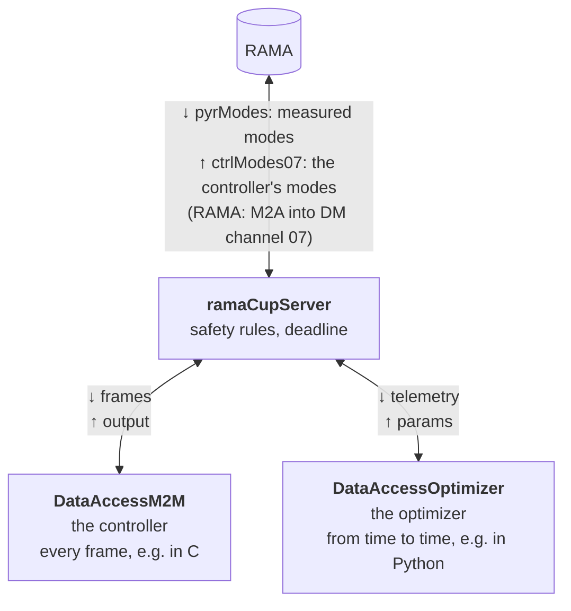

# RAMA Cup — controller competition framework

Write your own adaptive-optics **controller**, and if you like an **optimizer** that tunes it,
in any language, and run them on the RAMA pipeline (or its numerical twin, or a simulated
loop with no RAMA at all).

- The **controller** is real time: every frame, it receives the modes RAMA measured and returns
  the modes to apply. Python or C (C++, Rust, ... through the C library).
- The **optimizer** is optional and not real time: it reads the telemetry of the loop and
  changes the controller's params (a gain, filter coefficients...). It is a separate program,
  in any language: a C controller can be tuned by a Python optimizer.
- **ramaCupServer** sits between them and RAMA: it feeds the frames, writes the controller's
  output to RAMA, streams the telemetry to the optimizer, and protects the loop (a deadline
  every frame, no NaN, zero when the loop opens or the controller stops).



Each program only sees its **DataAccess**: an object holding the data it works on, kept up
to date. The design, and the reasons behind it, are in
[docs/design/interoperability.md](docs/design/interoperability.md).

**New here? Start with the [quick start guide](docs/quickstart.md)**: the example controller step
by step, on a simulated loop, then on RAMA with the twin, then with an optimizer and in C.

## Contents

- [Quick start guide](docs/quickstart.md) (a separate page)
- [1. Get rama, then rama_cup](#1-get-rama-then-rama_cup)
- [2. Try it in two minutes, no RAMA needed](#2-try-it-in-two-minutes-no-rama-needed)
- [3. Write a controller](#3-write-a-controller)
- [4. Write an optimizer](#4-write-an-optimizer)
- [5. Run on RAMA](#5-run-on-rama)
- [6. The control panel](#6-the-control-panel)
- [7. Record, replay, test](#7-record-replay-test)
- [7a. Campaigns: the Scheduler](#7a-campaigns-the-scheduler)
- [8. Reference](#8-reference)
- [9. Rules](#9-rules)
- [10. Layout](#10-layout)
- [11. Troubleshooting](#11-troubleshooting)

## 1. Get rama, then rama_cup

Two archives, installed one after the other: **rama** (dao, rama, the twin and their python environment; it
takes 10-20 minutes, once) and **rama_cup** (this repo; seconds, as often as you like). Nothing needs sudo.

**Already have dao + rama installed?** Skip to 1c/1d and use this repo from your install (`ramaStart`,
`ramaSelectReconstructor.py`, ... on your `PATH`, `import dao` working).

### 1a. Install rama from `rama-<date>.tar.gz` (provided by the RAMA team)

```bash
tar xzf rama-<date>.tar.gz
cd rama-<date>
./install.sh                 # press Enter to accept the default path (this folder)
```

`install.sh` asks for an install path (default: the extracted folder itself), builds daoBase, daoTools and
rama there, and creates a private conda environment named **`rama`** holding python, PyQt, OOPAO, torch and
every other dependency. It asks about CUDA only if a GPU toolkit is detected; answer *no* for a CPU-only
install. Expect ~10-20 minutes and a few GB of disk.

| created in the install path | what |
|---|---|
| `DAOROOT/`, `DAODATA/` | dao + rama binaries, python modules, data |
| `conda/` | private micromamba holding the `rama` env |
| `src/` | the sources it built from |
| `DAODATA/calibration/`, `DAODATA/cnn/Rama/` | reference calibration, trained CNN model (`ramaStartCNN` finds it through `AI4AO_DATA_DIR`, set by `env.sh`) |
| `env.sh` | environment file to source |

If `DAOROOT` already exists in that path it stops and asks. **In every new terminal:**

```bash
source <install path>/env.sh    # activates the rama env; sets DAOROOT / DAODATA / PATH
python -c "import dao, OOPAO, torch"    # sanity check
```

The install is fully independent of any other dao / rama / conda on the machine (`install.sh` ignores your
shell's conda and DAOROOT; `env.sh` strips them). Try it with the simulated pipeline, which needs no hardware:

```bash
<install path>/demo.sh          # ramaStart -sim + twin + ramaCtrl.py (asks before stopping a running RAMA)
```

The SHM files in `/tmp`, the semaphores and the tmux sessions use fixed names, so two RAMA installs (or an
install and a container) cannot run at the same time. Extra python packages for your controller go in the
`rama` env: `pip install <pkg>`. `./install.sh -h` lists the options; `./install.sh --docker [--tag NAME]` builds
a Docker image of the same install instead (Ubuntu 24.04, CPU only), run with
`docker run -it --rm --ipc=host -e DISPLAY -v /tmp/.X11-unix:/tmp/.X11-unix rama-cup` (you may need
`xhost +local:docker`; mount your controllers with `-v <folder>:/work`).
The RAMA team builds that archive with `install/make_archive.sh` (rama repo).

### 1b. Update or reinstall rama

Extract the new `rama-<date>.tar.gz` and run `./install.sh` again; the installer asks before touching an existing
`DAOROOT`. rama_cup is separate: run its installer (1c) again afterwards so that it finds the new install.

### 1c. Add rama_cup from `rama_cup-<date>.tar.gz`, on top of the rama install

```bash
tar xzf rama_cup-<date>.tar.gz && cd rama_cup-<date>
./install.sh
```

The installer asks how to configure itself (Enter takes the default of each question):

1. **Where rama is installed**: the rama install folder holding `env.sh` (or a DAOROOT folder). It proposes the
   one it finds next to the archive, and if your terminal already has a rama (env.sh sourced, or a `DAOROOT`
   from `~/.bashrc`) it asks whether to use it, it never assumes.
2. **The controller folder(s)**, `:` separated. Default: `rama_cup/controllers` of the extracted archive, where
   they stay (nothing is copied: keep this folder). A developer who already exports `RAMA_CUP_CONTROLLERS`
   keeps it.
3. **Where to store `RAMA_CUP_CONTROLLERS`**: written in `<rama install>/env.sh`, so every terminal that sources
   it finds the controllers. Without an `env.sh` it offers `~/.bashrc`, or prints the line to add.

It then runs `waf install` of rama_cup: the server, the panel `ramaCup`, `ramaStartCup`, `ramaCupLoop`, ... into
`$DAOROOT/bin`, the `ramacup` python package into `$DAOROOT/python`, the C library into `$DAOROOT/lib` and
`$DAOROOT/include`. It uses the `rama` python environment (and adds pyyaml to it if missing). `-y` takes the defaults without
asking; `./install.sh -h` lists the options. Then:

```bash
source <rama install>/env.sh
ramaCup                         # the control panel
```

The RAMA team builds this archive with `install/make_archive.sh` (`-h`; it records the commits and refuses
uncommitted changes unless `--allow-dirty`). It does not contain rama: rama_cup needs a recent rama
(`ramaQuickLook.py` in `$DAOROOT/bin`; the installer warns if it is missing). With `--developer` it
builds the developers' archive, `rama_cup-dev-<date>.tar.gz`: the same install without the Organizer's
tools (the Scheduler and the Reducer of 7a, `rama_cup_unpack_controllers.py`, the campaign example);
the panel then has no Campaign box. Everything a developer needs stays: the server, `ramaCupSim`,
`ramaStartCup`, the panel, the SDK, the examples, the Telemetry and Metrics, `rama_cup_prep_controller.py`.

### 1d. Developers: rama_cup from the sources

```bash
source <prefix>/env.sh          # or your own environment
cd rama_cup && waf configure --prefix=$DAOROOT && waf install
```

This installs the same things. Controllers and optimizers are never installed: point to your folder(s) with
`export RAMA_CUP_CONTROLLERS=<folder>[:<folder>]` (understood by the panel and `ramaStartCup`; the panel also
takes `--controllers`), e.g. once in your `~/.bashrc`:

```bash
echo 'export RAMA_CUP_CONTROLLERS=$HOME/dev/rama_cup/controllers' >> ~/.bashrc   # your folder(s)
```

Or run everything from this folder without installing: put the scripts on your `PATH` and the python package
on your `PYTHONPATH`:

```bash
export PATH=$PWD/scripts:$PWD/apps:$PATH PYTHONPATH=$PWD/sdk/python:$PYTHONPATH
```

rama_cup needs, in the python environment: numpy, pyyaml, pyzmq (ZeroMQ; without it Python programs use the
`lines` transport, see 8), PyQt5 for the panel; and libzmq to build a C controller (it comes with dao).

## 2. Try it in two minutes, no RAMA needed

`ramaCupSim` is the server on a **simulated loop** (96 modes of turbulence, noise, one frame
of delay, 200 frames per second): everything below works without RAMA, on any machine with
python. From this folder (or with rama_cup installed, without the paths):

```bash
export PATH=$PWD/scripts:$PWD/apps:$PATH PYTHONPATH=$PWD/sdk/python:$PYTHONPATH
cd controllers/integrator
```

**A controller.** The server in one terminal, the controller in another:

```bash
ramaCupSim integrator                                                  # terminal 1: the server, waiting
RAMA_CUP_DA=socket:ipc:///tmp/cup-integrator.sock python3 controller_integrator.py   # terminal 2: the controller
```

The server prints a line every 2 s: the frame rate, the round-trip latency, the misses, the params
in force, and the rms of the measured modes (about 0.13 with no correction, 0.05 with the
integrator). `RAMA_CUP_DA` tells the program where its server is.

**Change a param while it runs** (terminal 3): the controller checks it, applies it between two
frames, or refuses it, and the server says so:

```bash
echo '{"gain": 0.2}' > /tmp/cup/integrator.json      # accepted
echo '{"gian": 0.2}' > /tmp/cup/integrator.json      # refused: no such param 'gian'
```

**Add an optimizer**, in a third terminal: `optimizer_gain_search.py` tunes the integrator's gain from
the telemetry, while it runs. Stop it (Ctrl-C) whenever you like: the controller goes on.

```bash
RAMA_CUP_DA=socket:ipc:///tmp/cup-integrator.opt.sock python3 optimizer_gain_search.py   # terminal 3
```

**The controller in C, the optimizer in Python**: build the C integrator, then the same three
terminals with the C program (its name is `integrator_c`):

```bash
cd ../integrator_c
make                                                                        # builds ./controller_integrator_c
ramaCupSim integrator_c                                                     # terminal 1
RAMA_CUP_DA=socket:ipc:///tmp/cup-integrator_c.sock ./controller_integrator_c          # terminal 2
RAMA_CUP_DA=socket:ipc:///tmp/cup-integrator_c.opt.sock python3 optimizer_gain_search.py   # terminal 3
```

**Or all of it in one command**, each program in its own tmux session (`tmux attach -t
CUP_integrator_c_controller` to watch it, `_server`, `_optimizer` for the others):

```bash
ramaStartCup integrator_c --sim      # the server, the controller and its optimizer (its manifest names it)
ramaStopCup integrator_c
```

The optimizer can just as well run in a Jupyter notebook: set `RAMA_CUP_DA` in
`os.environ` before `ramacup.DataAccessOptimizer(...)`.

## 3. Write a controller

A controller is a few functions working on a **DataAccessM2M** `da`. Each frame, it reads
`da.input` (the measured modes) and sets `da.output` (the modes to apply): modes in, modes out,
RAMA converts them for the DM. The whole Python example, `controllers/integrator/controller_integrator.py`:

```python
import numpy as np
import ramacup


class Integrator(ramacup.Controller):
    def setup(self, da):
        da.params = {"gain": 0.2, "leak": 0.99}          # tunable: the panel or an optimizer may change them
        self.output = np.zeros(da.n_modes, np.float32)

    def step(self, da):
        if da.reset:                                     # the loop was opened: start from zero
            self.output[:] = 0
        self.output = da.params["leak"] * self.output - da.params["gain"] * da.input
        da.output = self.output


da = ramacup.DataAccessM2M(name="integrator")
ramacup.run(da, Integrator())
da.close()
```

| function | when | what it does |
|---|---|---|
| `init(da)` *(optional)* | once, first | get what takes time or must be released: a model, a GPU, threads, files |
| `setup(da)` | once, before the first frame | set `da.config` (fixed settings), `da.params` (their starting values), and your own state |
| `step(da)` | every frame | `da.input` → `da.output`. Keep it fast: the server waits one frame period at most |
| `cleanup(da)` *(optional)* | once, last, always (also on Ctrl-C or an error) | release what `init` and `setup` took |

What `da` holds:

| | |
|---|---|
| `da.n_modes`, `da.delay` | the number of modes (96 on RAMA), the loop delay in frames |
| `da.input`, `da.output` | this frame's measured modes (float32, `n_modes`), the modes you return |
| `da.config` | fixed settings, set in `setup`: your controller's structure. Never changes while it runs |
| `da.params` | tunable settings, always the current values. Changed by the panel or an optimizer, between two frames, only if they pass the check: the names must exist, with the same type (and length, for a list). `da.on_params(check)` adds your own check: `check(new_params)` returns `None` to accept, or the reason to refuse |
| `da.reset` | the loop was opened since the last frame: usually, zero your state |
| `da.params_changed`, `da.params_changes`, `da.params_source` | params changed since the last frame, which ones (`["gain"]`), by whom (`"panel"`, `"optimizer"`): recompute what depends on them |
| `da.rama_changed`, `da.rama_changes` | RAMA's calibration changed (`["I2M"]`, `["M2A"]`) |
| `da.seq` | this frame's number |

**Modes in, modes out.** `da.input` is a residual: what is left *after* your previous
correction. Push against it (minus sign) and accumulate, as the integrator does: you compute the
modes to apply, not a change. The server writes them into RAMA's modal channel 07, which RAMA
converts into DM channel 07 with its own modes-to-actuators matrix.

**In C**, the same functions in a structure, on the C library (`sdk/c/ramacup_da.h`). The whole
example is `controllers/integrator_c/controller_integrator_c.c`; its `Makefile` builds it from the
sources in this repository, else with an installed rama_cup's `-lramacup_da`:

```c
static int step(rcda *da, void *self)
{
    integrator *ctrl = self;
    if (rcda_reset(da))
        memset(ctrl->output, 0, ctrl->n_modes * sizeof *ctrl->output);
    const float *input = rcda_input(da);
    double gain = rcda_param(da, "gain"), leak = rcda_param(da, "leak");
    for (int mode = 0; mode < ctrl->n_modes; mode++)
        ctrl->output[mode] = (float)(leak * ctrl->output[mode] - gain * input[mode]);
    rcda_set_output(da, ctrl->output);
    return 0;
}
...
    rcda_controller controller = {.setup = setup, .step = step, .cleanup = cleanup};
    rcda *da = rcda_open(NULL, "integrator_c");          /* NULL: where $RAMA_CUP_DA says */
    int status = rcda_run(da, &controller, &state);
```

```bash
cc -O2 my_controller.c -I$DAOROOT/include -L$DAOROOT/lib -lramacup_da -lzmq -lm -o my_controller
```

C++ uses the same header. Other languages call the C library, or speak the protocol (JSON
messages on a socket) themselves: see the design, §3.7 and Appendix A.

**Register it** with a manifest next to it, `manifest_my_controller.yaml`, so that
`ramaStartCup` and the panel know how to start it. A manifest describes a controller, an
optimizer, or both (then the optimizer is started with the controller):

```yaml
controller:
  name: my_controller                       # the name given to DataAccessM2M
  command: ["python3", "my_controller.py"]  # run in this file's folder
optimizer:                                  # optional
  name: my_optimizer                        # the name given to DataAccessOptimizer
  command: ["python3", "my_optimizer.py"]
```

Optional controller fields: `optimizer` (the optimizer started with it, from any manifest;
default: this file's), `deadline_ms` (default one frame period), `miss` (`hold`, the default, or
`zero`: what is written when the controller misses a frame). In a campaign, a Run is one window
(1 minute on the sky and the bench at 500 Hz, 3 minutes on the twin), the same for everybody and
all of it measured: the controller uses it as it wants (section 9). Manifests are found in
`controllers/` and in the folders of `RAMA_CUP_CONTROLLERS`, and one folder below them: one
folder per controller, as the examples (`controllers/integrator/`, `controllers/integrator_c/`) and
rama_controller's.

**Its dependencies: `install_deps.sh`.** A controller brings what it needs with it, so that it
runs on a machine where nothing was installed for it. Next to its manifest, `install_deps.sh`
prepares a **conda environment named exactly after the controller**; the launcher
(`ramaStartCup`, `ramaStartOpt`, the panel) then runs the controller and its optimizer in it,
with nothing more to say. Without one, they run in rama_cup's own environment.

`ramaCupEnv` makes it simple: a copy of rama's environment (numpy, scipy, dao, pyzmq... are already
there), then whatever the controller adds. conda installs system libraries too (compilers,
libzmq, CUDA...) inside the environment: no root needed, no `apt install`.

```bash
#!/usr/bin/env bash
# install_deps.sh -- my_controller's environment: a copy of rama's, plus its requirements
set -euo pipefail
cd "$(dirname "$0")"
ramaCupEnv create my_controller "$@"                                         # --force: rebuild it
ramaCupEnv run my_controller python -m pip install -r requirements.txt       # or: conda install ...
```

**The folder is whole by itself.** Everything the controller runs or reads is in its folder
(code, built programs, models, data), and `install_deps.sh` installs only into the controller's
own environment, through `ramaCupEnv run <name> ...`. Never into `DAOROOT` (dao, rama, rama_cup),
rama's environment (shared by every controller) or `~/.local`: no plain `pip install`, no
`conda install` without `ramaCupEnv run`, no `--user`, no `sudo` / `apt`, no `make install`, no
absolute path or `../` in the manifest's commands. `rama_cup_prep_controller.py` refuses to pack a
folder that breaks this rule, and `install_deps.sh` runs guarded (`ramaCupEnvs`,
`rama_cup_unpack_controllers.py --install`): a plain `pip` is refused, and one that changed
`DAOROOT`, rama's environment or `~/.local` fails. A C controller builds inside its folder
(`make`), linking rama_cup's library from `$DAOROOT/lib` (read only).

**All of them at once: `ramaCupEnvs`** (with rama's environment active). It goes through every
controller folder (rama_cup's and `RAMA_CUP_CONTROLLERS`', or the folders given) and makes an
environment only where it adds something to rama's:

- an `install_deps.sh` that installs something (`ramaCupEnv run`, `pip`, `conda`, `mamba`): run
  when the environment is missing, and again when `install_deps.sh`, `requirements*.txt` or
  `environment*.yml` changed since (a fingerprint kept in the environment); else reused;
- one that installs nothing (only `ramaCupEnv create <name>`, the plain copy of rama's), or none:
  no environment, the controller runs in rama's. Its other steps (e.g. `make`) are still run,
  with `RAMA_CUP_ENV_BASE=1`, which makes `ramaCupEnv create` do nothing. A copy made earlier is
  reported as redundant (many GB, frozen at the day it was made); `--prune` removes it.

```bash
ramaCupEnvs --dry-run          # what it would do
ramaCupEnvs                    # do it
ramaCupEnvs --prune            # and remove the redundant copies
```

`ramaCupEnv path|run|remove <name>` finds, uses and deletes one environment; `ramaStartCup
--no-env` ignores the environments.

## 4. Write an optimizer

An optimizer is a separate program that tunes a running controller's params from the
telemetry, on a **DataAccessOptimizer**. It may take as long as it likes: the loop never waits
for it. `optimizer_gain_search.py` (in `controllers/integrator/` and `controllers/integrator_c/`), which tunes the `gain` of any controller that has one:

```python
class GainSearch(ramacup.Optimizer):          # simplified: the file also handles resets, bounds...
    def setup(self, da):
        da.config = {"optimize_every": 200, "step": 0.1, "gain_start": 0.2}
        self.best_gain, self.direction, self.best_rejection = da.config["gain_start"], +1, None

    def optimize(self, da):
        frames = da.telemetry.current                          # the frames run with the current gain
        rejection = rms(frames.input) / rms(frames.pol)        # residual / turbulence: lower is better
        if self.best_rejection is None:                        # the best gain, measured again
            self.best_rejection = rejection
        elif rejection < self.best_rejection:                  # the candidate beats it: kept, same way
            self.best_gain, self.best_rejection = da.params["gain"], rejection
        else:                                                  # it loses: back to the best, other way
            self.direction, self.best_rejection = -self.direction, None
            da.set_params({"gain": self.best_gain})
            return
        da.set_params({"gain": self.best_gain + self.direction * da.config["step"]})   # the next candidate


da = ramacup.DataAccessOptimizer(name="gain_search")
ramacup.run(da, GainSearch())
```

| | |
|---|---|
| `optimize(da)` | called every `config["optimize_every"]` frames run with the current params (default 100) |
| `da.telemetry` | the last frames (`config["telemetry_depth"]`, default 1000), oldest first: `.input`, `.output`, `.pol` (pseudo open loop: `input - output` of `delay` frames before), `(frames, n_modes)`; `.seq`, `.params_version`; `.dm_limited` (True where RAMA's DM limiter clipped or scaled down the command: that frame's pol is wrong; all False without RAMA) |
| `da.telemetry.current` | only the frames run with the current params, after the first `delay` frames that still see the old ones |
| `da.params`, `da.params_version` | the controller's current params, and a number that grows with each change |
| `da.set_params(changes)` | sends the change to the controller, which checks it; returns once it is in force, or raises `ramacup.ParamsRefused` with the reason |
| `da.controller_config`, `da.n_modes`, `da.delay` | about the controller it tunes |
| `da.reset`, `da.rama_changed`, `da.params_changed` | since the last `optimize`: the loop was opened, RAMA changed, someone else (the panel) changed the params |
| `da.held` | the operator holds the optimizer (the panel's *hold*): `optimize` is not called meanwhile |

It is an illustration, not a good optimizer: 200 frames of turbulence give a noisy rms. Each
example folder has a copy, in its manifest's `optimizer:` section (a `name` and a `command`, next to
the controller's), so that each folder runs on its own: integrator_c starts with it,
`ramaStartCup integrator --optimizer gain_search` asks for it (the manifest's `optimizer: null`
starts the integrator alone). A manifest may also have only an `optimizer:` section.

## 5. Run on RAMA

With the simulated pipeline and the twin (no hardware):

```bash
ramaCupPipeline start --twin --atm --r0 0.1     # clean (re)start of RAMA, reconstructor None
make -C controllers/integrator_c                # once, for the C example
ramaStartCup integrator_c                       # the server, the controller and its optimizer, on RAMA
ramaCupLoop close                               # the controller now drives the DM
ramaCupLoop open                                # the loop opens: channel 07 zeroed, da.reset in the controller
ramaStopCup integrator_c                        # stop; ctrlModes07 is zeroed
ramaCupPipeline stop                            # stop RAMA cleanly
```

On a pipeline that is already running (twin or hardware), first switch RAMA's own integrator
off, so that only your controller drives the DM. RAMA has two reconstructors (linear and CNN) and
one control chain; your controller reads `pyrModes`, RAMA's one modes stream: the modes of the
reconstructor RAMA selected (`/tmp/modesSelect.im.shm`: 0 linear, 1 NN), the CNN's by default.
`ramaSelectReconstructor.py NN --integrator none` (*cup controller (CNN input)* in the panel, or in
ramaCtrl reconstructor *NN* with integrator *None (external)*); the CNN must run. For the linear
modes instead: `ramaSelectReconstructor.py Linear --integrator none` (*cup controller (linear
input)*, or ramaCtrl *Linear* with *None (external)*) and `ramaStartCup NAME --input linear`; in a
campaign file, `input: linear`.

| command | what it does |
|---|---|
| `ramaStartCup <name>` | the server, the controller `<name>` and the optimizer its manifest names, each in its own tmux session, `CUP_<name>_server`, `_controller`, `_optimizer`. `--optimizer <opt>`: another one; `--no-optimizer`; `--fresh`: the code's params, not the last run's; `--sim`: on the simulated loop; `--record FILE.jsonl`; `--spin`: the server and the controller busy-wait (`RAMA_CUP_SPIN=1`), the lowest latency for two CPU cores at 100%. The controller connects on the `lines` transport, the optimizer on ZeroMQ |
| `ramaStopCup [<name>]` | stops the optimizer, the controller (its `cleanup` runs), then the server, which zeroes `ctrlModes07` |
| `ramaStartOpt <name> <opt>` / `ramaStopOpt <name>` | start, replace or stop the optimizer of a running controller: the controller goes on |
| `ramaCupLoop close` / `open` / `status` | RAMA's loop flag `lpCmd`, as the loop button of `ramaCtrl.py`: the controller only gets frames while the loop is closed |

**Params and hold, from the command line.** The server watches files in `/tmp/cup`
(`--params-dir`):

```bash
echo '{"gain": 0.3}' > /tmp/cup/integrator_c.json     # change params: the controller checks them
cat /tmp/cup/integrator_c.json                        # the params in force (the server writes them back)
touch /tmp/cup/integrator_c.hold                      # hold the optimizer; rm to release it
cat /tmp/cup/integrator_c.status.json                 # frames, misses, latency, params, optimizer...
```

A controller starts with the params of its `setup`, updated by `/tmp/cup/<name>.json` if the file
is there: the last values, the operator's or the optimizer's, survive a restart (`ramaStartCup`
says so). `ramaStartCup <name> --fresh` (or *fresh params* in the panel) starts from the code's
values instead.

`ramaCupPipeline start` **restarts cleanly**: it stops the controller, twin, CNN and
every RAMA process (waiting for them to exit, then SIGTERM / SIGKILL), removes the
shared memories and semaphores, then runs `ramaStart -sim`, starts the twin
(`--twin [--atm] [--r0 R0]`), selects reconstructor `None` (RAMA's own integrators
off, so **only your controller drives the DM**) and checks that WFS frames flow
(`pyrIm` counter advancing). It refuses to stop a pipeline that drives real hardware
(`alpaoCtrl` / camera controllers running) unless you pass `--force`; `--dry-run`
prints the steps. Everything it prints is also appended to `/tmp/ramaCupPipeline.log`. Choose where each part runs with `--i2m-device`, `--m2a-device`,
`--m2ann-device` (`cpu`, the default, or `gpu:N`) and `--twin-device` (`auto`, `cpu` or
`gpu:N`), e.g. `ramaCupPipeline start --twin --i2m-device gpu:0 --twin-device gpu:1`.
`--cnn [--cnn-device auto|cpu|gpu:N]` also starts the CNN reconstructor, waits for its
warm-up to finish and selects `NN` instead of `None`. `ramaStartCup <name> --start-rama --twin --atm --r0 0.1`
does both steps in one command. Then open the RAMA GUI with `ramaCtrl.py`.

## 6. The control panel

```bash
ramaCup                                  # opens ramaCupCtrl.py; --controllers <folder>, --params-dir /tmp/cup
```

| box | what it does |
|---|---|
| **RAMA pipeline** | *numerical twin*, *turbulence* and *r0* (also live, while the twin runs), where each part runs (I2M, M2A, NN M2A on CPU or GPU *N*; the twin on Auto, CPU or GPU), *start CNN*. **Start** is a clean restart of RAMA in simulation (`ramaCupPipeline start`), **Stop** stops it all. A pipeline driving real hardware is never stopped from here |
| **Controller and optimizer** | the controllers and the optimizers of the manifests (`manifest_*.yaml`; the one the controller's manifest names is selected). **Start** / **Stop** / **Restart** the controller with the selected optimizer; **Start optimizer** / **Stop optimizer** while the controller runs; **hold** the optimizer; *fresh params*: start from the code's params, not the last run's; *spin*: start with the server and the controller busy-waiting (`ramaStartCup --spin`, ticked when `RAMA_CUP_SPIN=1`). The status line: frame rate, loop, latency, misses, optimizer. The params field shows the params in force: type a change, e.g. `{"gain": 0.3}`, and **Apply**; a refusal and its reason appear in the log |
| **Loop / DM output** | the loop button (`lpCmd`, RAMA's one loop); the RAMA reconstructor: **cup controller (linear input)** or **(CNN input)** (RAMA's integrator off, only your controller, fed with the linear or the CNN's modes), Linear or NN (RAMA's integrator on those modes); **Quick look** opens `ramaQuickLook.py`; **Record telemetry**: *N* frames of the Telemetry into `$DAODATA/telemetry/<date>/` (section 7); the state of RAMA's integrator, in red when it also drives the DM |
| **Campaign (Scheduler)** | a campaign file (section 7a): **Check** (the dry run: the Runs, the time), **Start** (in tmux `CUP_campaign`), **Resume...** a stopped one, **Pause** / **Resume** (after the current Run), **Skip run**, **Abort run** (then pause), **Continue** (sky: the operator confirms the next Run), **Stop**; its state, the current Run and its progress, the Runs done with their score and Strehl; **Report** opens `report.html` |
| **Log** | the commands the panel ran and their output, params messages, errors |

A typical session: **Start** the pipeline (15-20 s), choose the controller and its optimizer,
**Start**, check that the reconstructor is *cup controller*, close the **Loop**, watch with
**Quick look**, change the params or let the optimizer do it, **Stop**.

To run just one controller, without the rest of the panel, use the mini window:

```bash
ramaCupLaunch.py [NAME | FOLDER]         # e.g. ramaCupLaunch.py ~/my_controller (a folder with its manifest_*.yaml)
```

Choose the controller (**Folder...** adds yours) and its optimizer (the one its manifest names is
selected; *(no optimizer)*: the controller alone), *simulated loop* (no RAMA) or *on RAMA* (the
pipeline already running), **Start** / **Stop** (`ramaStartCup NAME --optimizer OPT | --no-optimizer
[--sim]`, `ramaStopCup NAME`), and the loop button. While the controller runs, **Start optimizer** /
**Stop optimizer** (`ramaStartOpt NAME OPT`, `ramaStopOpt NAME`) and *hold*. The status line shows
the rate, the loop, the latency, the misses, the optimizer, the params and, on RAMA, the
controller's input: the modes of the reconstructor selected in RAMA (ramaCtrl: NN or Linear), on
pyrModes. **RAMA integrator off** switches RAMA's integrator off and keeps that reconstructor.

### The quick look


| # | what | how it works |
|---|---|---|
| 1 | **Info line** | For the displayed modes of the current frame: `rms` (standard deviation, the same figure as the modes plot of `ramaCtrl.py`), its 10 s mean, `max` (largest absolute mode) and the frame rate of `pyrModes`. |
| 2 | **modes** and **autoscale** | *modes* = how many modes are displayed and used in the statistics (up to 96). *autoscale* sets the vertical range of the modes plot: off keeps it where it is. |
| 3 | **Modes** | Signed amplitude of each measured mode (`/tmp/pyrModes.im.shm`, current frame). With the loop closed and a good controller these go towards zero. |
| 4 | **DM** | The DM command on the actuator map (colour scale symmetric around 0: blue negative, red positive) with its **min** and **max** below. The list picks **Combined** (`dm1Cmd`, what the DM receives) or **rama_cup (07)** (only your controller's channel). |
| 5 | **Image display**, row 1 | *Auto* = automatic levels (also autoscales the cut); off unlocks *min* / *max*. Colormap, **Linear / Sqrt / Log** scale (default Log), **Freeze**. |
| 6 | **Zoom** row | **Zoom** (blue = on) shows a square crop, off shows the full image (see below). **+** / **−** halve / double its size, the size box sets it (10-1000 px). The list picks the centre: peak, image center (default), optical axis or selected. **Select zoom**: click it, then click on the image to choose the centre. |
| 7 | **Avg**, **log cut**, statistics | *Avg* = sliding mean of the last *N* new frames (at most 20 on the full image). *log cut* = logarithmic vertical axis for the cut. The text gives max / mean / std of the image and the peak position in the science image. |
| 8 | **PSF image** | The science image (`/tmp/sciIm.im.shm`): a 100 x 100 pixel crop centred on the image centre by default. |
| 9 | **PSF cut** | Horizontal (blue) and vertical (orange) profile through the brightest pixel, in counts, within half the zoom size. |

**Zooming on a chosen spot.** Press **Zoom** to leave the zoomed view: the full image is
shown with a cyan **selection square**. Drag the square, resize it with its corner handle
(or use **+** / **−**), then press **Zoom** again to zoom on it. **Select zoom** followed by a
click on the image moves the square there.


The quick look uses no semaphores and writes nothing: it cannot disturb the RAMA loop or
your controller.

## 7. Record, replay, test

**Record** the frames of a run, then develop offline on them:

```bash
ramaStartCup integrator --record /tmp/night1.jsonl        # or: ramaCupServer.py integrator --record ...
RAMA_CUP_DA=replay:/tmp/night1.jsonl python3 controllers/integrator/controller_integrator.py  # writes /tmp/night1.jsonl.integrator.out.jsonl
RAMA_CUP_DA=replay:/tmp/night1.jsonl controllers/integrator_c/controller_integrator_c       # the same in C
```

The recording is JSON Lines: one line per frame (the measured modes, the output applied, the
params version), plus the loop openings, RAMA's changes and the params changes.
`ramacup.read_recording(path)` loads it as numpy arrays. On a recording the frames do not react
to your output: it checks that a controller runs and what it computes, not how well it corrects;
for that, use `ramaCupSim` or the twin. An optimizer runs on a recording too
(`RAMA_CUP_DA=replay:...`): its params changes are written next to it.

**The Telemetry** agreed by the Software Committee is the rest of what RAMA knows, mostly in its
shared memories: the WFS and science images, every DM channel, the loop's state, the
calibration, the telescope. For now a controller gets only the modes (`da.input`) and an optimizer
only its frames (`da.telemetry`: input, output, pol); the rest of the Telemetry is recorded for
each Run, for the Metrics. `ramaCupTelemetry.py list` gives the names. A Run's file,
`RUN.npz` + `RUN.json`, holds the Run's whole window (every WFS frame; the PSF once per science
image) in the format of RAMA's `ramaAutoSave.py`, plus the telescope and rama_cup's channel
(`ramaCupTelemetry.py record` alone: 3000 frames by default):

```bash
ramaCupTelemetry.py record --frames 3000 --out run.npz --meta meta.json   # the panel's Record telemetry; --seconds, --track-psf
ramaCupTelemetry.py list                                                  # the names, their SHMs, which exist
ramaCupMetrics.py run.npz [--recording run.jsonl]                         # its Metrics (score, Strehl, FWHM, DM limits...)
```

| per frame | once per Run |
|---|---|
| `wfs_roi` (the WFS's 4 pupils), `psf_roi` (256×256 around the star), `psf_yx`, the counters (WFS, PSF, DM, modes), `timestamp_utc`, `monotonic_ns`, `lpCmd`, `modesSelect`, `omgiRun`, `lpGain`, `lpLeak`, `controller`, `pyr_modes` (the selected reconstructor's), `pyr_modes_lin`, `pyr_modes_nn`, `dm_total`, `dm_flat`, `dm_int_linear` (RAMA's integrator), `dm_omgi`, `dm_turb`, `dm_ncpa`, `dm_offset`, and rama_cup's `cup_modes` (ctrlModes07), `dm_cup` (dm1Cmd07), `dm_limit_status` | `pyr_pupil`, `pyr_illum`, `pyr_bg`, `sci_bg`, `pyr_flatfield`, `pyr_ref`, `m2a`, `i2m`, `dm_map`; the telescope: `stationTelAirmass`, `stationTelRaDec`, `stationTelAltAz`, `stationTelParallactic`, `stationTelFocus`, `stationTelDome`, `stationTelGuideError`, `stationTelGuiding`, `stationTelOffsetTotal`; the JSON sidecar: the capture's configuration (FPS, DIT, gains, reconstructor) and the Meta-data |

**Tests**: `python3 -m pytest tests` runs the server on the simulated loop with the examples
(Python and C controllers, the optimizer, the params check, the hold, the safety rules,
recording and replay), the Metrics, the Reducer, and a campaign of the Scheduler with its resume
(in tmux), in about a minute, without RAMA.

## 7a. Campaigns: the Scheduler

The **Scheduler** runs Controllers one after the other under the same conditions, records each
Run's Telemetry and Meta-data, measures each the same way, and ranks them: the rama-cup's
story, from the Organizer's side. A campaign file lists the Runs
([controllers/campaign_example.yaml](controllers/campaign_example.yaml)):

```yaml
name: october
mode: twin                        # sim (no RAMA) | twin | bench | sky
reference: integrator             # run first (twin), or between the others (bench, sky)
defaults: {window: 180s, repeat: 1, delay: 1}   # the Run: seconds ("60s") or frames (an integer);
                                  # default: the mode's (sky, bench 60s; twin 180s)
runs:
  - {controller: team_a}
  - {controller: team_b, optimizer: none}
conditions:                       # the twin's: every Run under each, the same turbulence for all
  - {label: good, r0: 0.10, wind: 10, seed: 1}
```

```bash
ramaCupCampaign.py october.yaml --dry-run     # check it: the Runs, their order, the time they take
ramaCupCampaign.py october.yaml               # run it (the panel: Campaign > Start, in tmux CUP_campaign)
ramaCupCampaign.py --resume <folder>          # after a stop or a crash: the Runs left
ramaCupReport.py <folder>                     # the Reducer: reduced.json and report.html again
ramaCupReport.py <folder> --recompute         # ... and every Run's Metrics again, from its files
```

**A Run is one window, the controller's, all of it measured.** On the sky and the bench (500 Hz)
the window is 1 minute; on the twin, slower, 3 minutes (fewer frames than the sky's minute, but
enough to learn). The controller (and its optimizer) is started and set up first; then the loop
closes and the window runs. Within it the controller does what it wants: learn for 30 s with its
output at zero (the DM stays flat: the open loop), optimize, correct when it is ready. Everything
is recorded and measured over the whole window: the score (the rms of the residual modes) counts
the time spent learning. When the correction really started is read from the data, not declared:
`t_close`, the first frame from which the controller's output stays above 1 % of the residual;
the report gives it with the residual after it and the residual over the window (a line at
`t_close`), for information. The window may change (1, 2 minutes or more): `window` in the
campaign file.

Each Run may set its own `window`, `repeat`, `delay`, `fresh` (default true: the params in the
controller's code) and `gap` (s between two Runs); `seed` shuffles the Runs' order, `guardrails`
overrides the mode's limits. `mode: sim` with no `conditions` runs on the simulated loop, without
RAMA (the score only: no Telemetry file, no Strehl).

Each Run: the conditions set (twin), `ramaStartCup <controller> --fresh`, its Setup, the telemetry
recorder started (about a second to set up), the loop closed, the window (the server's recording
of every frame, the Telemetry file of the whole window), the loop opened, the controller stopped,
its Metrics. The recorder keeps up with the WFS (the frames it skips, if any, are counted in its
sidecar: `wfs_frames_skipped`) and keeps the PSF at the science camera's own rate (one crop per
science image), then saves its file with the loop open (a few s per 1000 frames). The guardrails end a Run early (misses, invalid
outputs, the controller gone, no light, divergence, the DM's limits; on the sky, the telescope);
the campaign goes on, or pauses (sky, 3 aborts in a row). Everything goes to
`$DAODATA/campaigns/<date>_<name>/`: `runs/NNN_<controller>_<condition>.{json,jsonl}` (the Run's result, the server's recording) and `.telemetry.{npz,json}` (the Telemetry file: the cameras' raw pixels, their background and flat-field once; its sidecar, with the PSF metrics),
`status.json`, `reduced.json` (the vectors of Metrics per controller and condition) and
`report.html` (the ranking by the default Metric, the rms of the residual modes over the window,
each Run against the reference next to it, `t_close`, the residual and the Strehl over each Run). The design: [docs/design/campaign.md](docs/design/campaign.md).

## 8. Reference

**Where to connect** (`RAMA_CUP_DA`, set by `ramaStartCup`; or given to `DataAccessM2M(name, uri)`):

| | |
|---|---|
| `socket:ipc:///tmp/cup-<name>.sock` | the controller, on RAMA's machine (ZeroMQ) |
| `socket:ipc:///tmp/cup-<name>.opt.sock` | its optimizer |
| `socket:lines+unix:///tmp/cup-<name>.lines`, `....opt.lines` | the same without ZeroMQ: one JSON object per line on a plain socket |
| `socket:tcp://host:port`, `socket:lines+tcp://host:port` | from another machine (give the server `--endpoint` / `--lines`, or the manifest's `endpoint` / `lines`) |
| `replay:<file.jsonl>` | a recording, offline |

**What rama_cup uses from RAMA** (the paths can be changed with the environment variables in
brackets):

| SHM | shape | | meaning |
|---|---|---|---|
| `/tmp/pyrModes.im.shm` (`RAMA_CUP_MODES_IN`) | 97×1 float32 | in | the measured modes: RAMA's one modes stream, the selected reconstructor's (`modesSelect`: the CNN's for `--input cnn`, the default, the linear one's for `--input linear` or a campaign's `input: linear`); the first 96 rows are the modes (`n_modes` = the columns of M2A) |
| `/tmp/ctrlModesOffset.im.shm` (`RAMA_CUP_MODES_OFFSET`) | 97×1 float32 | in | the NCPA offset on the modes (`pinv(dm1M2A) · dm1CmdOffset`, written by RAMA's `ramaModesOffset.py`): subtracted from the measured modes before the controller gets them (not on modes the input does not reconstruct: exactly 0, e.g. the CNN's 80-95), as RAMA's own integrators do, so the NCPA (Fast & Furious) stays on the DM and a controller never has to deal with it. `RAMA_CUP_MODES_OFFSET=none`: not subtracted. The server's status gives its rms (`ncpa_rms`); the Telemetry saves it once per Run (`ncpa_modes`) |
| `/tmp/ctrlModes07.im.shm` (`RAMA_CUP_MODES_OUT`) | 97×1 float32 | out | modal channel 07: RAMA converts it with `dm1M2A` into DM channel 07 (session `DM1_5_M2A_EXTERNAL`) |
| `/tmp/dm1M2A.im.shm` (`RAMA_CUP_M2A`) | 97×96 float32 | watched | modes → actuators: its number of columns is `n_modes`; a new one is a RAMA change |
| `/tmp/pyrI2M.im.shm` (`RAMA_CUP_I2M`) | | watched | WFS → modes: a new one is a RAMA change (`da.rama_changed`) |
| `/tmp/lpCmd.im.shm` (`RAMA_CUP_LOOP`) | 1×1 uint32 | in | RAMA's loop flag: 1 closed; 0 open: channel 07 zeroed, the controller gets `reset` |
| `/tmp/cupCmd.im.shm` (`RAMA_CUP_ENABLE`) | 1×1 uint32 | in | rama_cup's own on/off flag, created =1 |
| `/tmp/cupStatus.im.shm` (`RAMA_CUP_STATUS`) | 11×1 float32 | out | frames, misses, late, invalid, latency median and p99 (µs), 0, params version, optimizer connected, held, telemetry dropped |

`RAMA_CUP_DELAY` (default 1): the loop delay given to the programs. `RAMA_CUP_CONTROLLERS`:
folders of manifests. The server waits for each new frame of `pyrModes` with dao, which gives
every reader its own wait: your own readers of RAMA's SHMs do not disturb it.

**The safety rules**, applied by the server whatever the programs do: no frame before the
controller's `setup` is done; an output later than the deadline is a miss (the last output is
held, or zero; after 50 misses in a row, zero); an output for an older frame is dropped; a wrong
length or a NaN gives zero for that frame; loop open: zero, and no frames; the controller gone:
zero; the optimizer only ever changes params, through the controller's check, and a crashed
optimizer changes nothing for the loop.

## 9. Rules

- CPU only; `step` must keep up with the loop rate.
- A Run is one window, the same for everybody (1 minute on the sky and the bench at 500 Hz, 3 on
  the twin), all of it measured: learn, optimize and correct within it, as you like.
- Submit your controller (and optimizer) as one folder with its manifest and its `install_deps.sh`
  (section 3: its conda environment). The folder holds everything it needs; nothing is installed
  outside of it and of its own environment (never in `DAOROOT`, rama's environment or `~/.local`). To hand it in, run `rama_cup_prep_controller.py` in the folder: it checks the
  manifest and packs the whole folder, whatever is in it, into `<name>.tgz`, next to it (`tar xzf <name>.tgz` gives the folder back).
- Judged on Strehl / residual RMS, stability, efficiency and originality.

**Running the controllers handed in.** Gather the `.tgz` files in one folder (a repo, for
instance), unpack them there, and point rama_cup at that folder:

```bash
rama_cup_unpack_controllers.py <folder>        # unpacks each <name>.tgz into <folder>/<name>/
export RAMA_CUP_CONTROLLERS=<folder>           # ramaStartCup <name>, the panel: they are all there
```

It refuses an archive that is not one folder named after its manifest's controller, or that holds
links or paths leaving its folder; `--keep` leaves the folders already unpacked untouched;
`--install` also runs each folder's `install_deps.sh`, which builds the controllers' environments
(it runs code from the archives: use it on archives you trust).

## 10. Layout

```
rama_cup/
├── apps/ramaCupServer.py      the server and safety gate (on RAMA, or --sim)
├── apps/ramaCupSources.py     RAMA's shared memories, and the simulated loop
├── apps/ramaCupTools.py       manifests and tmux, for the scripts and the panel
├── apps/ramaCupTelemetry.py   the Telemetry (the Committee's content): its names and SHMs, which the server serves; a Run's file
├── apps/ramaCupMetrics.py     the Metrics of a Run (score, Strehl, FWHM, residual, DM limits...)
├── apps/ramaCupCampaign.py    the Scheduler: a campaign of Runs; apps/ramaCupModes.py: sim, twin, bench, sky
├── apps/ramaCupReport.py      the Reducer: the vectors of Metrics, the ranking, report.html
├── apps/rama_cup_prep_controller.py   packs a controller's folder into <name>.tgz, to hand it in
├── apps/rama_cup_unpack_controllers.py   unpacks the .tgz handed in, into the folder rama_cup runs from
├── sdk/python/ramacup/        DataAccessM2M, DataAccessOptimizer, the runner (import ramacup)
├── sdk/c/                     ramacup_da.h / .c: DataAccessM2M in C (cJSON bundled)
├── controllers/               the examples, one folder each, as a controller is handed in (manifest,
│                              install_deps.sh, README.md): integrator/ (Python), integrator_c/ (C),
│                              each with the optimizer gain_search (Python);
│                              make_tgz.sh (their .tgz, in dist/), campaign_example.yaml (a campaign of them)
├── gui/ramaCupCtrl.py         the control panel; gui/ramaCupLaunch.py: the mini window for one controller
├── scripts/                   ramaStartCup, ramaStopCup, ramaStartOpt, ramaStopOpt, ramaCupSim,
│                              ramaCupEnv (a controller's conda environment),
│                              ramaCupLoop, ramaCupPipeline, ramaCup (the panel)
├── tests/                     end-to-end tests on the simulated loop (pytest)
├── docs/quickstart.md         the quick start guide
├── docs/design/               the design: interoperability.md, campaign.md
├── docs/gui/                  screenshots and the tools to regenerate them
├── install/                   make_archive.sh + install.sh: the rama_cup tgz, installed on top of rama
└── wscript                    waf install: bin/, python/ramacup, lib/libramacup_da.a, include/
```

## 11. Troubleshooting

- **`import dao` fails / `ramaStart` not found**: `source <folder>/env.sh` (rama env), or install rama (1). `ramaCup` / `ramaStartCup` not found: run rama_cup's installer (1c), or put `scripts/` and `apps/` on your `PATH` (1d). `import ramacup` fails: `sdk/python` on your `PYTHONPATH`, or install rama_cup.
- **`no server at ipc:///tmp/cup-<name>.sock`**: start the server first (`ramaCupSim <name>`, `ramaStartCup <name>`), and give `DataAccessM2M` the server's name.
- **`refused by the server: this server serves 'x', not 'y'`**: the name in your program and the server's (the manifest's `name`) differ.
- **`waiting for /tmp/ctrlModes07.im.shm`**: the RAMA pipeline is not running, or is older than modal channel 07: restart it (`ramaCupPipeline start`).
- **No WFS frames (`pyrModes` frozen) while RAMA's integrator is off**: the twin only steps when a DM channel is written; the server writes channel 07 again after a second without frames, which restarts it.
- **The DM does not move / moves twice as much**: the loop must be closed (`ramaCupLoop status`), `/tmp/cupCmd.im.shm` must be 1, and RAMA's own integrator must be off (`ramaSelectReconstructor.py NN --integrator none`, or `Linear`).
- **Many misses**: `step` is slower than the frame period: see the latency in the server's line, raise `deadline_ms` in the manifest, or make `step` faster (C).
- **The latency is high** (hundreds of µs at a low frame rate): most of it is the processes waking up between frames, not the data. The controller on `lines` (what `ramaStartCup` gives it) rather than ZeroMQ, and `ramaStartCup --spin`, bring it down: on the simulated loop at 45 Hz, the C integrator's round trip goes from 240 µs (ZeroMQ) to 100 µs (lines) and 60 µs (lines, spin).
- **A Python program without ZeroMQ** (`import zmq` fails): use the `lines` endpoints (8), or `pip install pyzmq`.
